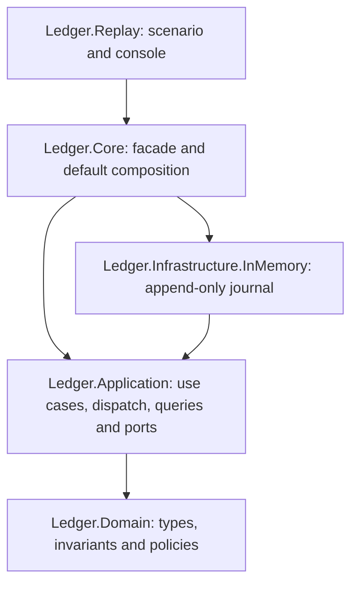

# Clean Architecture and extension guide

This is the implemented design, not a future banking platform. It preserves the behavior of
`fcc7c71370ac62dda4117c5155b1375a3a9c9092`. All core state remains in memory, under one writer.

## Boundaries and dependencies



These are source dependencies. Runtime execution calls the journal through the application's
`ILedgerJournal` port. Domain has no references to the other projects. Infrastructure knows
the port; Application never references the concrete in-memory adapter. Direct constructor
injection keeps object construction inspectable without a container or mediator framework.

`Ledger.Core` is a small compatibility facade and composition root. It preserves the
`AccountLedger` methods used by the original regression tests, while forwarding to real
application use cases. It contains the explicit list of default handler registrations.
The assessment constants and input fixture moved to Replay; the tests link that fixture as
source, so neither reusable library nor facade includes assessment-specific data.

## Business ownership

- **Account and currency:** account validation, decimal precision and rounding belong to Domain.
  Account does not own the whole journal, drive the clock or calculate all financial products.
- **Monetary postings:** immutable `LedgerEntry` records are the balance source of truth.
  `ReversalRules` validates principal compensation; `ReversePosting` appends the corresponding
  opposite entries. Neither changes the originals or silently refunds fees.
- **Reservations:** `Authorization` enforces active-state and capture-limit rules.
  `AuthorizeFunds`, `SettleAuthorization` and `ReleaseAuthorization` orchestrate transitions.
  Latest reservation state is derived from immutable `AuthorizationChange` records.
- **Financial products:** `IOverdraftFeePolicy`, `IInterestPolicy` and `InstalmentAllocator`
  own calculations. `AssessOverdraftFees` owns chronological assessment and posting;
  `CapitalizeInterest` owns preparing and validating all accruals before capitalization.
- **Workflow:** `ProcessEvent` owns input identity, day boundaries, routing and outcomes.
  `FinalizeLedger` owns the final-input watermark. `LedgerSession` contains only workflow
  state (recorded day, closed-through day and finality), not financial history.
- **Queries:** `LedgerQueries` projects value-dated balances, latest authorizations and current
  availability synchronously from the journal. Reads do not post or retroactively decide anything.

The append-only journal, reservation lifecycle and daily product assessment are distinct
responsibilities within one process. They are not separate services or distributed transactions.

## Operation dispatch: Strategy plus explicit Registry

Each business operation implements `IEventHandler`. Its `Kind` is an `EventKind` key;
`Handle` executes the use case using a validated account and arrival context.
`EventHandlerRegistry` copies registrations at construction and routes by dictionary lookup.
There is no operation switch in the dispatcher or coordinator.

`EventKind` is now a string-backed value type with the six existing well-known keys.
A client can introduce `new EventKind("Client.PromotionalCredit")` without editing a
central enum or the dispatcher. Keys are case-sensitive and should be stable and namespaced.
Blank registration keys and duplicate registrations fail at startup. Unregistered input
kinds produce the same recorded business decline as the former unsupported switch branch.

An example client extension (not part of the assessment replay):

```csharp
using Ledger.Application;
using Ledger.Core;
using Ledger.Domain;

public sealed class PromotionalCredit : IEventHandler
{
    public EventKind Kind => new("Client.PromotionalCredit");

    public void Handle(FinancialEvent input, OperationContext context)
    {
        decimal amount = PostingRules.PositiveAmount(input, context.Account);
        context.Post(input, amount, EntryKind.Credit);
    }
}

// At the client's composition root:
var ledger = new AccountLedger(accounts, feePolicy, interestPolicy, windowDays,
    additionalHandlers: [new PromotionalCredit()]);
ledger.Process(new FinancialEvent("PROMO:1", 1, 1,
    new EventKind("Client.PromotionalCredit"), "A", 12.345m));
```

`ExtensionTests` executes this kind of extension through the unchanged production coordinator,
including exact retry, sequence ordering and finality checks. The default six use cases remain
registered in the facade. Replacing a built-in registration is intentionally rejected there;
a client needing a different handler set can compose Application and the adapter directly.

This is a deliberate extension boundary, not a promise that arbitrary banking features need
no domain changes. A genuinely new posting classification still needs a domain decision;
multi-capture, FX, expiry and fee refunds require new semantics and tests. A handler must validate
before appending, be deterministic and respect the supplied context. The registry is not an
isolation boundary for untrusted code and does not turn failures into atomic transactions.

## Execution contract

For each input, `ProcessEvent` performs these steps in this order:

1. Return an identical prior result, or throw on conflicting reuse of its ID.
2. Check finality, identity, reserved source prefixes and days.
3. Advance the recorded high-water day and assess earlier days before the input, when needed.
4. Resolve the account and dispatch its operation. A business decline appends an outcome;
   insufficient authorization also retains its Rejected transition.
5. Append the accepted outcome, then revisit closed days chronologically for backdated fees.

This ordering is observable. E10 remains last with recorded day 6. Day 5's fee is assessed
before E9. Historical approvals and declines stay as observed. Retained charges survive a
principal reversal. Finalization assesses through the last day, then prepares all daily
rounded accruals before appending capitalization and freezing new input. Exact retries still
work after finalization. There is no implicit expiry or reopening.

Boundary and post-success policy failures remain fatal at their original positions. Earlier
valid appends can already exist. Introducing rollback would change AMBIGUITIES decision 22
and is outside this behavior-preserving refactor.

## Journal and projections

`InMemoryLedgerJournal` owns private append-only lists and one sequence generator shared by
postings, authorization transitions and input outcomes. Fee assessments and final accruals
retain their original record shapes; they are not assigned new sequence numbers. There is no
update/delete API. Collection getters return detached read-only snapshots, preserving old views.

Projections use scans instead of cached balances. This reduces consistency risk during the
refactor but is not a performance improvement: repeated snapshots add allocations, scans remain
linear, and repeated fee passes can become quadratic over a growing stream. Rebuildable indexes
are a separate, measured optimization. A future index must follow append order synchronously,
handle backdated suffixes and reconcile to the authoritative history.

## Compatibility, tests and tradeoffs

The original 39 regression cases and the real opt-in failing expiry probe remain. Existing
test bodies did not need rewriting; a global Domain import resolves the moved types.
`scenario-baseline.json` was captured before refactoring, at every input boundary and finality,
and compares all histories, daily balances, availability, input fields and sequence values.
It is an additional behavior guard, not an independent mathematical oracle; the existing
hand-calculated assertions and allocator conservation tests remain necessary.

Additional tests cover external registration, duplicate/blank keys, unknown kinds, domain
authorization limits and the documented policy-failure boundaries. Replay output is also
compared to the original captured output. Test fixtures use files; reusable ledger code does not.

Domain types now live in `Ledger.Domain`; callers add that import. `EventKind` changed from an
enum to a named value type, so enum casts and numeric enum serialization are not compatible.
The assessment's operation names and all observable replay data remain unchanged. No binary
compatibility or persisted-format migration is claimed for the former assessment library.

The cost is more files, explicit construction and a small facade project. The gain is ownership
that follows business concepts, compile-time inward dependencies, independent use cases and
an executable client extension path. No web host, database, durable journal, event bus, generic
repository framework, background scheduler or third-party NuGet package was introduced.
